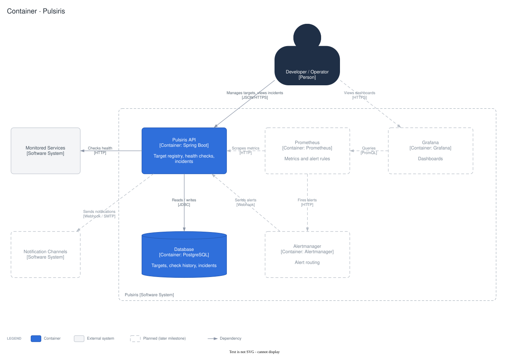

# Pulsiris

Pulsiris is an application operations and reliability toolkit. It checks HTTP services on a schedule, tracks their health and keeps a record of every incident. It runs the same locally, on a VPS or in the cloud.

## Features

- **Target registry:** HTTP endpoints with their own interval, timeout and failure thresholds.
- **Health checks:** a target goes DOWN after 3 consecutive failures and recovers after 2 successes. Results from before a monitoring gap never count towards an alert.
- **Incidents:** opened and resolved automatically from health changes, with acknowledge, manual resolve, notes and a timeline.
- **Retention:** raw check results for 30 days, daily summaries for 13 months.
- **REST API** documented with OpenAPI.

## Tech stack

| Area | Tools |
|---|---|
| Backend | Java 21, Spring Boot 4.1, Spring Modulith 2.1 |
| Data | PostgreSQL 18, Flyway |
| Tests | JUnit 5, Testcontainers, WireMock, ArchUnit |
| Runtime | Docker, Docker Compose |

## Architecture

A modular monolith with three modules: `registry`, `checks` and `incidents`. Each owns its own database schema, and modules react to each other through persisted events. Diagrams and decisions are in [docs/architecture](docs/architecture/README.md).



## Quickstart

Requires Docker. Choose a database password first; it is stored as a file outside git.

```bash
mkdir -p docker/secrets
openssl rand -base64 24 | tr -d '\n' > docker/secrets/db_password
docker compose -f docker/compose.yaml up -d --wait
```

PowerShell:

```powershell
New-Item -ItemType Directory -Force docker/secrets | Out-Null
Set-Content docker/secrets/db_password -Value 'choose-a-password' -NoNewline -Encoding ascii
docker compose -f docker/compose.yaml up -d --wait
```

| | |
|---|---|
| API docs | http://localhost:8080/swagger-ui.html |
| Health | http://localhost:8080/actuator/health |

Register a service to monitor:

```bash
curl -i localhost:8080/api/targets -H 'Content-Type: application/json' \
  -d '{"name": "Example", "endpointUrl": "https://example.com", "intervalSeconds": 30}'
```

Stop:

```bash
docker compose -f docker/compose.yaml down      # removes the containers, keeps the database
docker compose -f docker/compose.yaml down -v   # also deletes the database
```

## Development

Requires Java 21 and Docker.

```bash
docker compose -f docker/compose.yaml up -d --wait postgres   # Postgres on 127.0.0.1:5433
cd backend
./gradlew bootRun
./gradlew test                                                # Testcontainers starts its own Postgres
```

`bootRun` connects with the password `pulsiris`. If your secret file holds a different one, set `DB_PASSWORD`.

## Configuration

Optional overrides go in `docker/.env`; [docker/.env.example](docker/.env.example) lists them, including the memory limit and JSON logs.

## Docs

- [Architecture](docs/architecture/README.md): diagrams and decisions
- [ADRs](docs/adr/)
- [Troubleshooting](docs/operations/troubleshooting.md)
